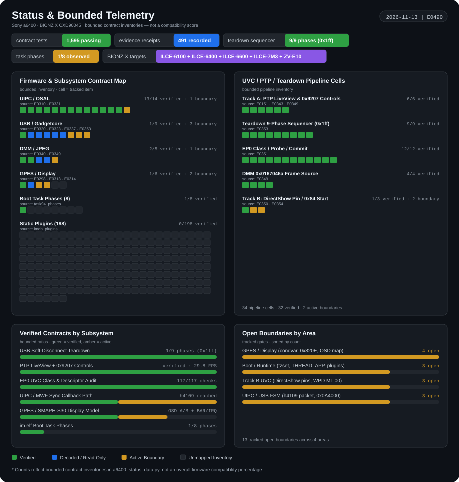

# Sony a6400 · BIONZ X (`CXD90045`) Research & Execution Platform

An evidence-backed **clean-room research platform** for the Sony ILCE-6400 (a6400) and
the Sony BIONZ X `CXD90045` camera family: an offline original-code execution
environment, a decoded hardware/OS contract reference, and a low-latency USB / UVC
streaming workstream you can contribute to **without owning a camera**.

We study original ARM/Thumb firmware code, the Linux and Sony service contracts it runs
on, and the physical camera's behaviour — and we label every result by what it actually
demonstrates: offline execution, read-only observation, authored demonstration or a
physically verified operation. Nothing here is a percentage of "firmware compatibility".

## Project pillars

| Pillar | What it means | Current state |
| --- | --- | --- |
| **1 · Clean-Room Firmware Emulator (`CXD90045`)** | Execute original `im.elf` code, OSAL/UIPC messaging, GPES GPU contracts and the USB FSM offline, with no hardware risk | Bounded, opt-in contracts. Original code executes through startup and event dispatch; the full camera boot is **not** proven |
| **2 · Low-Latency Monitoring & Native UVC (`CinemaHUD` + Track A/B)** | Glass-to-glass latency measurement and control with the camera's own USB transport | **Track A** (host-driven pipelined PTP + Android SGSR 1.0 shader) has a physically verified liveview link. **Track B** (camera-side composite UVC push from DMM JPEG buffers) enumerates but cannot yet stream |
| **3 · Multi-Device BIONZ X Platform Support** | Share the SoC/kernel contracts across a6400, ZV-E10, a6100, a6600 and a7 III instead of forking the emulator | A typed `TargetProfile` registry with a verified a6400 profile, a reference ZV-E10 chain and explicit stubs for the rest |

## Research status

**2026-11-11 | [E0352](docs/evidence/0352-offline-teardown-soft-disconnect-fix.md).**
Offline disassembly and Unicorn close the current loop on the Track B transport: the
`Could not RenderStream to connect pins` failure is ranked to **START endpoint selection**
(the EP0 class handler is byte-identical to the physically streaming reference,
[E0351](docs/evidence/0351-offline-renderstream-verdict-and-crash-safe-logging.md)), and
the post-session Mass Storage loss has a root cause plus a clean **unconfigure-first
soft-disconnect** sequencer that replaces the teardown that lost the proven order
([E0352](docs/evidence/0352-offline-teardown-soft-disconnect-fix.md)). The decisive
forward result is the **P1 probe**: a foreign `GET_JPEG` sees real DMM frames at 29.8 FPS
while the host PTP stream keeps running
([E0349](docs/evidence/0349-p1-foreign-get-jpeg-succeeds-in-pc-remote.md)), and the
composite itself enumerates as parent + PTP + Camera with DirectShow visible
([E0350](docs/evidence/0350-trackb-transport-enumerates-but-renderstream-fails.md)). Run A then ran the unconfigure-first soft disconnect **on hardware**: the composite enumerated, the daemon exited clean, and Mass Storage returned without a battery pull ([E0353](docs/evidence/0353-run-a-teardown-success.md)).
Earlier in the same window, kernel-to-user **sync callback delivery** ran the original
h4109 callback to completion ([E0332](docs/evidence/0332-sync-callback-delivery-first-invocation.md)),
and the architecture decision plus safe read-only DMA probe are recorded in
[E0348](docs/evidence/0348-uvc-monitor-architecture-probe-and-reference-client.md) /
[ARCHITECTURE_UVC_MONITOR.md](docs/ARCHITECTURE_UVC_MONITOR.md).

Recorded suite: 1283 tests. Each result above is bounded by its own record; no UVC frame,
no control write and no full firmware boot is claimed.



### Subsystem status matrix

| Subsystem | Demonstrated & verified | Remaining boundary | Evidence |
| --- | --- | --- | --- |
| Firmware execution — offline | Original ARM/Thumb code reaches `im.elf` and the first event-dispatch phase | Full camera boot unproven; 1/8 task phases and 0/198 static plugin definitions | [status data](tools/research/a6400_status_data.py) |
| UIPC / USB FSM — offline | MWF dispatch, ObjMsg wire layout, opt-in kernel-to-user sync callback delivery; the original h4109 callback executes and completes | `h4109`/`h4110` packet payload format and the downstream post path are still unmodelled (`sync_callback_packet_format_unmodelled`); no FSM transition claimed | [E0327](docs/evidence/0327-mwf-objmsg-wire-format.md), [E0331](docs/evidence/0331-usb-lane-local-queue-vs-sync-callback.md), [E0332](docs/evidence/0332-sync-callback-delivery-first-invocation.md) |
| Host enumeration — offline | Byte-verified 173-byte UVC+PTP descriptor decoded; `SET_CONFIGURATION`/endpoint selection modelled; ObjMsg dispatch reaches FSM event `0x13` | Inbound `SET_CONFIG` cannot yet be delivered on the original sync lane end-to-end | [E0337](docs/evidence/0337-emulator-uvc-ptp-preparation-and-0a4002-broadcast.md) |
| Display / GPU — physical capture + offline model | Camera OSD A/B confirmed as 640×480 RGBA4444; GPES BAR/IRQ contracts decoded; the opt-in engine model reaches a second original guest signal | Keyed `0x820E` completion, guest condition release, OSD mapping and the rasterizer remain open; no verified GUI frame | [E0298](docs/evidence/0298-safe-osd-capture-and-sugilite-correction.md), [E0313](docs/evidence/0313-readonly-physical-gpes-bar-and-grm-state.md), [E0314](docs/evidence/0314-gpes-bar-irq-contract-engine-model.md) |
| PTP liveview — physical | Original PC Remote mode delivers real 1024×680 sensor JPEGs; a foreign `GET_JPEG` sees the same DMM frames at 29.8 FPS under host load | Simultaneous UVC + PTP with reliable teardown is not demonstrated | [E0349](docs/evidence/0349-p1-foreign-get-jpeg-succeeds-in-pc-remote.md), [E0151](docs/evidence/0151-pc-remote-liveview-and-uvc-verified.md) |
| Composite USB / UVC — physical | Authored composite enumerates as parent + `MI_00` PTP + `MI_01` Camera, with DirectShow seeing an ILCE-6400 video device | DirectShow cannot connect the UVC pins (`trackb_directshow_pin_connect_unproven`); post-session MSC needed a power cycle; no UVC frame | [E0348](docs/evidence/0348-uvc-monitor-architecture-probe-and-reference-client.md), [E0350](docs/evidence/0350-trackb-transport-enumerates-but-renderstream-fails.md) |
| Track B teardown — physical (Run A) | Nine-phase unconfigure-first soft disconnect ran on hardware: `[a6400_td] phases=1ff failed=9 reconnect=1`, stop verified at 181 TIDs, clean daemon exit, and **Mass Storage returned without a battery pull** (window enumeration parent + MI_00 + MI_01) | UVC frames are still unproven (no host liveview consumer in Run A; DirectShow RenderStream not retested) — next is Run B with host stream + ETW capture | [E0353](docs/evidence/0353-run-a-teardown-success.md), [E0352](docs/evidence/0352-offline-teardown-soft-disconnect-fix.md), [E0351](docs/evidence/0351-offline-renderstream-verdict-and-crash-safe-logging.md) |
| UVC transport — authored pattern | Static MJPEG 1280×720 at 29.9592 FPS over 180 frames; the ZV-E10 UVC chain is hash-pinned as reference | Sensor feeder unwired; the ZV-E10 UVC stack is **not enabled** on the a6400 and physical load is outside the read-only scope | [E0143](docs/evidence/0143-uvc-720p-test-transport-and-30fps-verified.md), [E0321](docs/evidence/0321-zve10-uvc-enablement-manifest.md), [E0322](docs/evidence/0322-zve10-uvc-overlay-plan.md) |
| Native monitor / storage — physical | Original help and a fixed `IFSYS getdriveinfo A` reply verified; A: identified as SD | General command behaviour and competing-consumer ownership remain open; the diagnostic SD journal is unwritten | [E0234](docs/evidence/0234-ordinary-pcremote-ifsys-query-answered.md), [E0222](docs/evidence/0222-physical-sd-volume-device-association.md) |
| Custom menu — authored demonstration | Our interface drawn on the camera display | Does not establish original Sony menu behaviour, navigation or settings — [photo](docs/images/framebuffer-camera-menu.png) | [authored demo](docs/images/framebuffer-camera-menu.png) |
| Multi-device targets | Typed a6400 profile with sourced kernel symbols, UIPC queues and USB identity; ZV-E10 reference chain; stubs carry no claims | Only the a6400 is a verified execution target | [`src/a6400/targets/`](src/a6400/targets/catalog.py), [ADDING_A_BIONZX_CAMERA](docs/ADDING_A_BIONZX_CAMERA.md) |
| Validation — local suite | 1283 tests pass offline, including structure, target-profile and documentation-sync contracts | Bounded contracts, not compatibility or deployment safety | [tests/](tests/README.md) |

## How to contribute (no camera required!)

Roughly 90% of the open work is offline Python: decoders, emulator contracts, tests and
documentation. If you have a laptop and this repository, you can contribute today.

**Top 3 open tasks right now**

1. **`h4109`/`h4110` packet payload for the `UsbControl` FSM** — the sync lane now
   delivers, but its packet format is unknown. Decode it and carry an inbound
   `SET_CONFIG` from the queue to a real FSM observation.
   Start at [`src/a6400/execution/usb_sync_callback.py`](src/a6400/execution/usb_sync_callback.py).
2. **Offline Unicorn model of UVC EP0 `PROBE`/`COMMIT` and a clean MSC soft-disconnect
   teardown** — the sequencer exists ([E0352](docs/evidence/0352-offline-teardown-soft-disconnect-fix.md));
   it needs coverage of every fail-closed path before another physical run.
   Start at [`tools/native_camera/uvc_ptp_soft_disconnect.c`](tools/native_camera/uvc_ptp_soft_disconnect.c).
3. **GPES keyed `0x820E` completion** — resolve the cross-thread completion through the
   driver-resolved context pointer and the guest condition release, so the display path
   can progress without host-injected state.
   Start at [`src/a6400/execution/guest_gles.py`](src/a6400/execution/guest_gles.py).

Where to read next:

- [Contributing to UVC / PTP](docs/CONTRIBUTING_UVC_PTP.md) — six scoped workstreams with acceptance criteria.
- [Adding a BIONZ X camera](docs/ADDING_A_BIONZX_CAMERA.md) — own another body? Register a `TargetProfile` with evidence.
- [Consolidated UVC/PTP status](docs/UVC_PTP_STATUS.md) — the dated progress log.
- Issue labels: [`uvc`](https://github.com/ivica00/sony-a6400-research/issues?q=label%3Auvc),
  [`ptp`](https://github.com/ivica00/sony-a6400-research/issues?q=label%3Aptp),
  [`good first issue`](https://github.com/ivica00/sony-a6400-research/issues?q=label%3A%22good+first+issue%22),
  [`boundary`](https://github.com/ivica00/sony-a6400-research/issues?q=label%3Aboundary).

A clean recorded boundary — "the original code stops here, with this PC and reason" — is a
valid contribution on this project.

## Quick start

No camera is needed for the offline suite. Python 3.10+ with the pinned dependencies from
[`requirements.txt`](requirements.txt):

```powershell
# Windows (PowerShell), using the existing environment
.\venv\Scripts\python.exe -m pip install -r requirements.txt
.\venv\Scripts\python.exe -m unittest discover -s tests -q
```

```bash
# Linux / macOS
python3 -m pip install -r requirements.txt
python3 -m unittest discover -s tests -q
```

| Check | Command |
| --- | --- |
| Full offline suite | `python -m unittest discover -s tests -q` |
| Structure + targets + docs sync | `python -m unittest tests.test_repository_layout tests.test_target_profiles tests.test_research_status_sync -v` |
| Status card is current | `python -m tools.research.render_research_status --check` |
| Interpreter probe (offline) | `python -m tools.research.probe_interpreter` |
| Interface launchers (Windows) | [`scripts/`](scripts/) — `launch_cinemahud_ptp.bat`, `launch_cinemahud_android.ps1`, `launch_cinema_mpv.bat`, `start_camera_shell.bat` |

Run first-party scripts as modules from the repository root
(`python -m tools.research.<tool>`, `python -m legacy.<prototype>`). Firmware, backups and
generated artifacts stay local; a source clone alone does not reproduce the physical
experiments.

## Repository map

| Path | Contents |
| --- | --- |
| `src/a6400/execution/` | Bounded guest execution and verified OSAL/UIPC/USB/GPU contracts |
| `src/a6400/targets/` | `TargetProfile` schema, fail-closed validation and the multi-device registry |
| `src/a6400/visualization/` | Status renderers (treemap PNG and the SVG card's data source) |
| `tools/research/` | Analysis, original-code probes, experiment runners and the status generator |
| `tools/native_camera/` | Authored native helpers, module sources and the UVC/PTP transport work |
| `probes/` | Bounded read-only ARM probe for other BIONZ X bodies (+ build/receipt harness) |
| `tests/` | Contract, regression and repository-structure checks |
| `docs/evidence/` | Dated claims, identities, observations and limitations |
| `docs/` | Architecture, workflows, contributor guides and the research-status card |
| `scripts/` | Windows launchers, resolving the repository root from their own location |
| `legacy/` | Historical HLE/UI prototypes; explicitly not compatibility evidence |
| `android/`, `android-client-ref/` | Track A client and the CinemaHUD reference client |
| `camera-daemon/` | Track B camera-side composite UVC push daemon (offline, gated) |
| `firmware/`, `backups/`, `artifacts/` | Local preserved inputs and generated results; excluded from Git |

See [docs/REPOSITORY.md](docs/REPOSITORY.md) for the layout history and launch paths.

## Epistemic and safety boundaries

This section is part of the method, not a disclaimer.

- **Evidence policy.** Host-written navigation, rendering, UI or camera decisions are
  **not** firmware compatibility. An offline contract result, a read-only observation, an
  authored demonstration and a physically verified operation are reported separately, and
  each claim links to a dated record.
- **Zero flash modification.** No internal-flash writes, no firmware installation, no
  driver replacement and no boot changes are part of ordinary work. Firmware and captures
  stay local; only hash-checked read-only inputs are consumed.
- **Clean-room.** Original code owns application logic and rendering in fidelity
  experiments. Unknown services are never replaced by fabricated success values, synthetic
  messages or host-invoked callbacks; a run stops with its PC, arguments and reason.
- **Physical scope.** Read-only camera observations need no extra approval; writes, mode
  switches, module loads and teardown experiments do, and they are never incidental test
  steps. Bulk `/dev/mem` sweeps are banned — one caused a USB drop and camera reboot; the
  incident and its restriction are recorded in the safety note of [AGENTS.MD](AGENTS.MD).
- **Per-boot values.** Only kallsyms addresses are ASLR-free. Library bases, the gadgetcore
  fd and every DMM address change between boots; the target profiles record what was
  observed and never hardcode a boot's values as a contract.
- **Bounded claims.** A passing fixture, an instruction count or a rendered frame proves
  only its own bounded contract. "Not yet verified" is a normal, publishable state.

## Research records

- [Evidence index and record format](docs/evidence/README.md)
- [Architecture](docs/ARCHITECTURE.md) · [UVC monitor architecture](docs/ARCHITECTURE_UVC_MONITOR.md) · [Roadmap](docs/ROADMAP.md)
- [Live camera / emulator workflow](docs/LIVE_CAMERA_EMULATOR_WORKFLOW.md) · [Dependency workflow](docs/DEPENDENCY_WORKFLOW.md)
- [Contributing](CONTRIBUTING.MD) · [Repository layout](docs/REPOSITORY.md) · [Agent rules](AGENTS.MD)
- [Archived README and earlier milestones](docs/archives/README-2026-11-09.md)

## Scope and attribution

Independent research; not affiliated with or endorsed by Sony. Sony, a6400, ILCE-6400 and
BIONZ X are their respective owners' trademarks. Firmware packages, extracted proprietary
binaries, device backups and raw RAM captures remain local. Custom graphics, passing
fixtures and instruction counts do not establish complete firmware compatibility or
deployment safety. Unknown behaviour must remain explicit.
