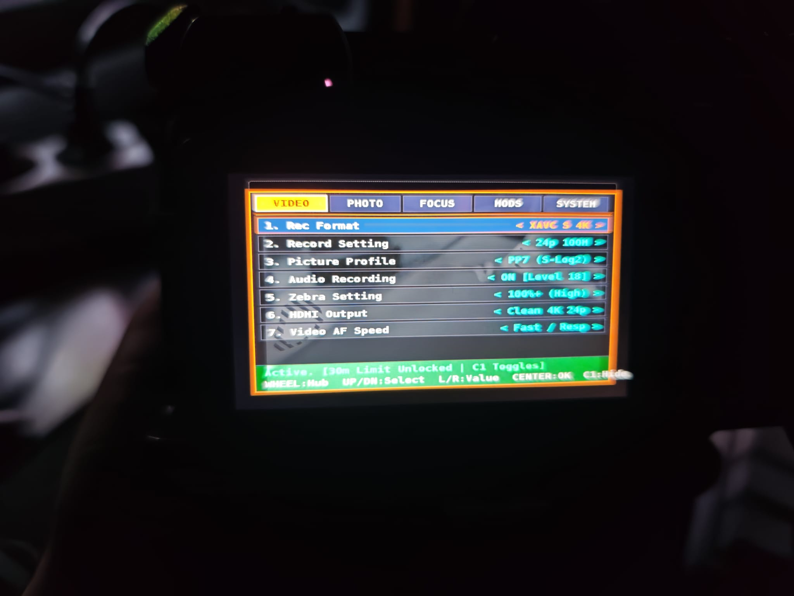

# Sony a6400 firmware execution research

## Demonstrated on physical hardware

This project researches Sony ILCE-6400 firmware execution and hardware contracts. Physical camera experiments and bounded original-code emulation are documented separately; a custom display or a successful USB transfer does not establish complete firmware compatibility.

### Framebuffer writes on the camera — demonstrated

The photograph below shows our custom interface drawn on the physical a6400 display, demonstrating successful framebuffer writing. The interface and its displayed labels are a homebrew rendering demonstration: the photograph alone does not verify the listed settings, recording-limit changes, original Sony menu navigation, or complete firmware emulation.



### UVC mode — demonstrated transport, unfinished integration

Physical USB UVC transport of a static MJPEG test pattern at **1280 × 720 and approximately 30 FPS** was verified: FFmpeg decoded the received JPEG and DirectShow measured **29.9592 FPS over 180 frames**. The image below is the test pattern, not live sensor output. See [E0143: physical transport evidence](docs/evidence/0143-uvc-720p-test-transport-and-30fps-verified.md).


**Current boundary (2026-11-09):** the combined PC Remote/UVC/PTP session can initialize and stop on the camera, but the latest 90-second Windows test reports composite-parent **Code 10**, with no usable PTP/UVC children. Sensor-to-UVC feeder integration remains unfinished; the shared module keeps video streaming disabled. See [E0208: current result and next steps](docs/evidence/0208-windows-90s-parent-code10-and-feeder-boundary.md) and [UVC/PTP status](docs/UVC_PTP_STATUS.md).

## Historical research checkpoints

The entries below record individual experiments in time order as originally documented. Their limitations and intermediate failures must be read alongside the current result above.

[E0144](docs/evidence/0144-native-jpeg-receiver-ownership-and-dma-allocation.md): Located and live-source-checked the native LIRO JPEG receiver and verified its 12-buffer ownership contract. Corrected `0x50e` to DMM UnitType; ordinary builds now preserve native allocation failure instead of substituting a fixed window. Three physical 256 KiB kernel-owned DMA lifecycle cycles pass. Native sensor acquisition remains unfinished; all 599 tests pass and the experimental module is unloaded.

[E0143](docs/evidence/0143-uvc-720p-test-transport-and-30fps-verified.md): Physical Bulk IN test-pattern transport now works: FFmpeg decoded 1280x720 MJPEG, 180 DirectShow frames measured 29.9592 FPS, and the local monitor served a JPEG. Camera returned to Mass Storage; all 599 tests pass. This is a static JPEG transport milestone; native sensor JPEG production and ownership remain unfinished.

[E0142](docs/evidence/0142-uvc-bulk-endpoint-bridge-and-physical-boundary.md): Bulk endpoint wrapper bridge and byte-count ABI fix implemented; 599 emulator tests and 53 ARM controls pass. Physical frame transport remains unresolved. Final experiment remains in UVC with no debugger access; recover Mass Storage before further testing. PnP remains OK with inbox usbvideo. Camera payload writes were RAM-only.

[E0135](docs/evidence/0135-uvc-port-device-node-and-gadget-callback-abi.md)
finds two concrete UVC port blockers: a device-table collision and an8-byte
gadget callback-layout difference. A node-only ARM candidate is built OFFLINE
with original executable sections unchanged; it is explicitly not deployable.
Physical UVC remains off; descriptor/callback bridging is the next boundary.

[E0134](docs/evidence/0134-zve10-v203-reference-uvc-stack-and-jpeg-path.md)
extracts the user-supplied ZV-E10 2.03 reference without running its updater.
It identifies actual Sony UVC video/audio modules, userland streaming integration
and720p25/30 descriptors missing from the inspected a6400 equivalents.
No reference component is installed on a6400;1080p/UVC compatibility is unproven.

[E0133](docs/evidence/0133-gadget-infrastructure-ptp-gates-and-liveview-test-plan.md)
audits the actual Sony gadgetcore stack, identifies separate PTP handle/status
filters and records a RAM-only experiment plan. No active UVC function or1080p/30
stream is demonstrated. Package JPEG settings are distinguished from live backup.

USB monitor discovery (2026-11-07): [E0132](docs/evidence/0132-usb-liveview-jpeg-source-and-width-gate.md)
identifies source-equal JPEG live-view code and verifies its normal width gate
accepts320/640/1024 and routes1920 to fallback. A separate configuration-derived
path remains to investigate. **1080p/30 USB streaming is not yet demonstrated.**
Camera inspection was read-only; no streaming mode or hook was enabled.

[E0113](docs/evidence/0113-active-menu-reference-confirmed-and-cache-coherence.md)
confirms the live menu resource has one reference while a later USB snapshot
had zero; original release1-to-0 succeeds as a narrow control. The coupled
resource-list state also differs, so full activation remains unproven.
[E0114](docs/evidence/0114-coupled-active-resource-model-and-arena-capture.md)
prepares a combined active-state capture rather than guessing missing ownership.

Latest continuation: [E0111](docs/evidence/0111-resource-accounting-list-ownership-and-snapshot-lifetime.md)
executes original accounting, synchronization, resource-list lookup/unlink and
libc fastbin free. It stops on a zero-reference release in combined MENU/USB
captures. [E0112](docs/evidence/0112-active-menu-resource-lifetime-observer.md)
prepares the targeted active-menu/resource capture to test that lifetime mismatch.
Physical main-menu touch and completed activation remain unproven.

Current checkpoint (2026-11-06): the normal-USB root debugger is installed and
the original active-menu lookup, 145-widget geometry, row/model association and
252 geometric hit checks execute on captured camera state. Original activation
still stops before a resource-manager accounting mutation, even with an explicit
captured main-thread/TLS control. **Physical main-menu touch is not working.**
See [E0109](docs/evidence/0109-original-activation-thread-context-and-resource-boundary.md),
[the live-camera/emulator workflow](docs/LIVE_CAMERA_EMULATOR_WORKFLOW.md), and
[the publication checkpoint](docs/evidence/0110-research-checkpoint-and-github-publication.md).
Raw firmware, RAM captures and checkpoints remain local and are not in Git.
The entries below preserve earlier milestones and their then-current boundaries.

New-owner GLES follow-up: [E0065](docs/evidence/0065-original-gles-new-owner-lifecycle-and-process-binding.md) executes original allocation, open/query/release and completion in one captured-state CPU instance (2465 instructions). All 431 tests pass. It adds explicit task-identity/address-space checks: the main process cannot reuse the selected captured task's ownership or address limit. No framebuffer pixels are demonstrated.

Original GLES follow-up: [E0064](docs/evidence/0064-captured-gles-open-kernel-locks-and-queries.md) identifies source-matched GLES code, device and reciprocal task ownership in package WBI. Original open and kernel lock instructions return after 437 instructions with real retain-count changes and restored locks; original ioctl queries and kernel copy failures are verified. 423 tests pass. This is an isolated captured-state experiment: main remains at E0063, and cache/GPU hardware, new-process ownership and framebuffer output remain unresolved.

Graphics follow-up: [E0063](docs/evidence/0063-backup-nread-decoder-and-gles-boundary.md) implements preset-backed `Backup_nread` and metadata queries, corrects extended/variable descriptor offsets against original ARM getters, and fixes missed wakes on separate reply queues. Two 150M-budget process runs stop at 80,739,451 instructions opening `/dev/dmpgles2`; original GLES windows identify kernel task/lock/DMA and runtime cache-callback prerequisites. 411 tests pass. No framebuffer pixels or GPU execution are demonstrated.

SD emulation contract: [E0062](docs/evidence/0062-sdhci-adma2-bridge-and-physical-volume-read.md) completes the end-to-end SDHCI ADMA2 host controller bridge (`tools.research.sdhci_bridge`), linking authentic register contracts (base `0xf2a00000`) and ADMA2 descriptor parsing directly to read-only SD sector storage (`\\.\E:`, exFAT, 249,966,592 sectors / 119.19 GB). Verifies CMD17 single-block read of exFAT VBR (LBA 0, OEM `EXFAT   `, SHA-256 `ed765d4031463b2c3ad0d08d02fef20f2d9333843f9dc4080b8264d6b89a7a56`) and CMD18 multi-block reads of camera root directory clusters (`PRIVATE`, `AVF_INFO`). 386 tests pass.

SD emulation contract: [E0061](docs/evidence/0061-sd-dma-scatter-gather-and-adma2-contract.md) resolves the user buffer pinning pipeline (`mcmnd_scatter_makescatterlist`), scatterlist adapters (`mmc_single_scatter_list`), and 8-byte ADMA2 descriptor table generation (`mmc_hw_exec_command`) across `mcmn_drv.ko` and `mmc_drv.ko`. 380 tests pass.

SD emulation contract: [E0060](docs/evidence/0060-sd-host-hardware-contract-and-recursive-lock.md) resolves `struct host_hw` (208 bytes / 0xd0), `ip_func_ops` (48 bytes), and recursive mutex locking (`mmc_os_lock_sem_long`). Identifies SDHCI physical base 0xf2a00000, present-state polling (0x2c), and activity LED GPIO. 374 tests pass.

SD emulation contract: [E0059](docs/evidence/0059-sd-serialized-transfer-and-card-reference-init.md) verifies the 8-stage serialized transfer pipeline from ioctl 0x10f to MMCP operations, establishes `struct mmcp_card` (0x508 bytes) with `state[0]=host_hw`, and maps host semaphore locking. Original preparation executes to the lock relocation at 24 events. 367 tests pass. Next host controller semaphore implementation, MWF responder, and DMA scatter-gather contract.

SD emulation contract: [E0058](docs/evidence/0058-sd-read-ioctl-and-preparation-state.md) verifies configured read callbacks and the matching16-byte ioctl0x10f request/status layout. Original preparation now reaches its first unknown card-state reference after23 events; default controls remain unchanged.362 tests pass. Runtime transfer/initialization and physical completion remain open.

Current focus — SD communication: [E0057](docs/evidence/0057-sd-communication-layers-and-original-read-bounds.md) traces media-path messaging, handle/read callbacks and the MMCP read path with34 completed REA queries. Original invalid read controls return-1; a valid control stops at an unsupported preparation helper.361 tests pass. Runtime callback/controller/card communication remains unresolved; injection/update research is outside current scope.

Current focus — SD inputs and update reachability: [E0056](docs/evidence/0056-sd-card-inputs-and-update-surface.md) inventories81 card files read-only, surveys374 preserved software inputs and verifies targeted updater functions with WSL/REA. MS-source labels remain unproven for retail SD updates; one `/mnt` path is internal flash.357 tests pass; no exploit/custom update or main/UI advancement demonstrated.

Original trace allocator: [E0055](docs/evidence/0055-original-trace-uipc-allocator-runtime-state.md) follows the kernel-wrapper branch through32 instruction events and confirms the nested42-byte allocation request ABI. It stops at the unknown UIPC descriptor before ioctl; no allocation response is supplied. All354 tests pass; main startup and GUI remain unchanged.

Original constructor returns: [E0054](docs/evidence/0054-original-pthread-constructor-return-and-trace-ipc.md) completes selected original pthread initialization and the constructor after168 instructions/44 stores. A direct initializer with fresh GRM output reaches a trace-message allocation boundary at202 total instructions. All354 tests pass; actual transport, kernel callback and main GUI remain unresolved.

Original loader-to-constructor chain: [E0053](docs/evidence/0053-original-loader-to-sysconf-constructor-chain.md) executes the original loader's page-size producer under declared entry assumptions, then original PLT/sysconf/getpagesize and constructor code. It reaches pthread_mutex_init after86 instructions/17 stores without a fabricated sysconf return. All351 tests pass; pthread/kernel callback/IPC and main GUI remain unresolved.

Original constructor prefix: [E0052](docs/evidence/0052-original-client-constructor-and-page-size-dependency.md) executes32 original instructions/seven stores with guarded uninitialized object storage and reaches sysconf30. Original libc analysis connects that call to a loader-global field; no page-size reply is invented. All351 tests pass; constructor/main/GUI completion remains open.

Original callback prerequisite: [E0051](docs/evidence/0051-original-grm-mutex-thread-state-boundary.md) follows original locking code to an unsupplied kernel thread-stack-state read and guards against accepting host zeros. Lookup/client regressions and all348 tests pass. No callback/service completion or main/GUI advancement is claimed.

Original reply consumer: [E0050](docs/evidence/0050-original-ma-client-status-consumption.md) pairs fresh original GRM output with a constructed client return context and executes original Thumb status handling. Success reaches a184-byte object-allocation boundary; absent-name error reaches cleanup. All348 tests pass. Transport, mutex and object creation remain open; main/GUI unchanged.

Original failure cleanup and startup direction: [E0049](docs/evidence/0049-original-extent-failure-and-startup-lookup-branch.md) completes the selected captured DMM allocation failure path and verifies that original startup skips new allocation when existing-name lookup succeeds. Next connect the original client to the captured lookup contract with verified service effects. All345 tests pass; no main/GUI advancement.

Original allocation prefix: [E0048](docs/evidence/0048-original-dmm-allocation-state-transitions.md) executes 2,019 original instructions, consumes free record65 and constructs internal handle0x0441, while retaining explicit state-mutation guards. Execution stops before inner extent allocation; the output remains unfilled. All345 tests pass; main startup and GUI boundary unchanged.

Captured DMM ownership: [E0047](docs/evidence/0047-original-dmm-handle-and-captured-ownership.md) executes original unit lookup/handle construction and returns `0x0417`, matching `gl_common`. The active record owns the matching 32 MiB extent; an inactive record retains a stale pointer. All 342 tests pass. Actual allocation/open and main GUI remain unresolved.

Original open dependency: [E0046](docs/evidence/0046-original-grm-open-and-dmm-handle.md) executes the captured startup-shaped graphics open to its first unsupported DMM message-allocation call. It verifies that existing named state does not bypass allocation and identifies a returned DMM handle omitted by decompiled call arguments. All 342 tests pass; main execution and GUI remain unchanged.

Original allocator lookup: [E0045](docs/evidence/0045-wbi-page-tables-and-original-grm-lookup.md) translates captured allocator memory through explicitly selected saved page tables and executes the original lookup plus kernel comparison. It returns `gl_common`'s 32 MiB range with the original retain-count mutation; an absent-name control returns -9. All 342 tests pass. Startup allocation ownership and GUI remain unresolved.

Latest allocator research: [E0044](docs/evidence/0044-wbi-grm-reciprocal-list.md) validates six reciprocal captured allocator nodes, including `gl_common` with a 32 MiB pool. Original lookup instructions are identified; head address translation and ownership remain unproven. All 339 tests pass; main execution and GUI boundary unchanged.

New input milestone: [E0043](docs/evidence/0043-wbi-memory-and-recovered-logging-input.md) decodes the preserved warm-boot image, recovers the identified 3,772-byte `/setting/ulogio.bin` buffer and DMM log area, and executes the original logging lookup to return its address/size. All 644 decoded sections agree with fwtool; all 339 tests pass. This is packaged snapshot data, not a live camera boot or a new GUI milestone.

Latest investigation: [E0042](docs/evidence/0042-elapsed-timer-versus-calendar.md) confirms software microsecond timer units through original conversion instructions and shows how the separate calendar service uses elapsed timer differences. DMM records access timestamps, not a photograph count. All 334 tests pass; hardware/logging inputs and the application/GUI boundary remain unresolved.

Latest investigation: [E0041](docs/evidence/0041-freerun-existing-state-and-timer-message-abi.md) verifies that original freerun setup preserves an already selected mode, and connects DMM's timer request through registration and OSAL wrappers to the original counter callback/body layout. All 331 tests pass; initial hardware/logging state and the application/GUI gate remain unresolved.

Latest scripted investigation: [E0040](docs/evidence/0040-utimer-clock-origin-and-rollover.md) identifies a separate free-running counter at `0xf240310c`, traces the system counter's initialized clock offset and executes the original rollover helper with explicit controls. Repeated planning reuses all eight relevant REA results. All 328 tests pass; no new GUI/application milestone.

New research workflow: [targeted dependency planning and cached REA](docs/DEPENDENCY_WORKFLOW.md) follows original ARM module calls/data references, prepares bounded WSL queries and reuses hash/profile-checked evidence. [E0039](docs/evidence/0039-dependency-planner-and-evidence-cache.md) demonstrates static cache hits and a four-query run without starting Ghidra. All 326 tests pass; the application/GUI boundary is unchanged.

Latest research: [E0038](docs/evidence/0038-timer-programming-and-setting-partition.md) executes 51 original instructions and records all 12 timer setup stores without inventing register responses. Original boot mounts `/setting` from partition 2, whose image is not preserved; the required `ulogio.bin` remains unsupplied. All 318 tests pass; the application/GUI boundary is unchanged.

Latest research: [E0037](docs/evidence/0037-timer-pointer-producer-and-native-wsl-rea.md) executes original initialization slices for all four timer pointers and reaches the actual counter-register read without supplying a value. REA works again through direct WSL execution; the preserved-input scan finds no candidate raw logging-memory configuration. Application/GUI boundary unchanged; all 315 tests pass.

Latest prerequisite trace: [E0036](docs/evidence/0036-dmm-timer-runtime-and-log-configuration.md) executes the original kernel timer path to its unsupplied runtime pointer table and identifies `/setting/ulogio.bin` as the boot input for DMM's log-area lookup. That configuration is not in the preserved inventory. Graphics allocation and the application boundary remain unresolved; all 310 tests pass.

Latest research: [E0035](docs/evidence/0035-dmm-configuration-and-boot-reservations.md) executes the original DMM configuration parsers and allocation-state initializer. Graphics unit `0x280` selects a configured 32 MiB extent; its actual allocation remains blocked by timer/shared reservation-log prerequisites. Application execution remains at E0034 with no original GUI or fb0 request. All 306 tests pass.

Goal: run original and modified ILCE-6400 firmware so that behavior comes from Sony's executing software, with hardware interfaces implemented and validated against a physical camera.

**Current status: research prototype, not a validated camera emulator.** The legacy prototype supplies navigation, state and pixels in Python. A separate headless probe now executes the original interpreter with a small set of explicit guest contracts. A rendered legacy screen is not evidence of firmware compatibility.

Start with [the roadmap](docs/ROADMAP.md), [architecture](docs/ARCHITECTURE.md), [current assessment](docs/CURRENT_STATE.md), and [validation protocol](docs/VALIDATION.md).

First implementation steps are documented in [Phase 0 progress](docs/PHASE0_PROGRESS.md): local input inventory, strict execution auditing, and regression checks.

Execution milestone: [the original interpreter reaches its first syscall](docs/evidence/0003-original-interpreter-boundary.md) in a separate headless probe. Its default mode stops before supplying any kernel response.

Follow-up: [the guest heap contract](docs/evidence/0004-guest-brk-contract.md) optionally answers `brk` and advances to the next unsupported request, `uname`. Default probe mode still supplies no kernel responses. Original UI execution remains unimplemented.

The [guarded kernel-identity policy](docs/evidence/0005-guarded-kernel-identity.md) advances to a check of `/etc/ld.so.preload` after 3,091 interpreter instructions. Unknown runtime identity fields remain guarded; that policy stops before filesystem responses.

Earlier execution milestone: [the read-only image filesystem](docs/evidence/0006-read-only-guest-filesystem.md) advances the original library search to 5,078 instructions, stopping at successful `stat64` metadata for `/lib`. That policy stops before a successful library read.

Latest milestone: [guarded inode metadata](docs/evidence/0007-guarded-inode-metadata.md) adds the explicit `metadata` policy. The original linker opens a library and reads its first 512 bytes, reaching 6,493 instructions before a guard stops use of its unknown device number. This partial research contract does not establish complete metadata or camera behavior; earlier policies remain available.

Fidelity update: [original runtime mount evidence](docs/evidence/0008-runtime-mount-boundaries.md) identifies a possible writable `/etc` overlay and compressed/direct storage alternatives. Add `--respect-runtime-mounts` to `--syscalls metadata` for a conservative run: it stops at unsupplied `/etc` after 3,091 instructions. The deeper snapshot run assumes static image contents; its missing-path answers are not established camera-runtime facts.

[Storage driver evidence](docs/evidence/0009-storage-driver-consumers.md) now traces the table's consumers and decompressed partition numbering, including an isolated nine-instruction original-code check. Compressed-device registration is conditional; no mounted device identity has been selected.

[Compressed-header evidence](docs/evidence/0010-compressed-header-comparison.md) now executes the original five-instruction magic comparison. Both preserved updater filesystem headers mismatch; a constructed magic-only control matches without validating an image. The updater-to-physical-storage representation remains unverified, so neither mount identity nor `/etc` contents are supplied.

[Updater write-path evidence](docs/evidence/0011-updater-image-write-path.md) traces the original partition-image loop to `WriteAll` and the normal `write` interface. A corrected ARM PLT decoder identifies the calls. The virtual input reader and downstream storage driver still require tracing; the updater is never executed by this research tool.

[Buffer and storage evidence](docs/evidence/0012-ring-buffer-and-storage-write.md) resolves the recovered RingBuffer table's read/advance candidates and records a storage helper that rejects compressed-partition writes before the ordinary `emmc_seq_write` branch. Producer bytes, completed hardware writes and runtime mounts remain unverified.

[Producer and physical storage trace](docs/evidence/0013-producer-and-physical-storage-trace.md) connects the updater's `crypter.elf` pipeline (`Dec_Scramble` decryptor to `RingBuffer::WriteData`, body-loader execution to `UpdaterBody::Execute`) and traces `emmc_blk_kthread` directly into `emmc_write`, validating the decompression callback guard table (`uz_emmc_do_compress`) versus `emmc_seq_write` -> `write_block_retry` (CMD24/25) -> `exec_emmc_data_cmd` -> `sdhci_emmc_exec_data_cmd` (DMA setup). Nonvolatile flash contents, device identity selection and `/etc` runtime state remain open.

[Boot selection and root device trace](docs/evidence/0014-boot-selection-and-root-device.md) traces `kmod/devno.ko` (`udif_devnodes`), `sbin/init` (`mnts`, `pivot_root`, driver phases), and `mount.conf`. Major 252 is verified for all flash block devices: `/lib` on `/rootfs` resolves to `st_dev = 0xfc87` (compressed `/dev/dnflasha7`) or `0xfc07` (uncompressed fallback `/dev/nflasha7`). Static rootfs `/etc` is verified empty; `sbin/init` mounts `/dev/nflasha10` (vfat, read-write) over `/etc` at boot, explaining the `--respect-runtime-mounts` boundary.

[Guarded mmap2 and dynamic library load](docs/evidence/0015-guarded-mmap2-and-library-load.md) introduces the explicit `mmap` syscall policy (`GuestMmap`). Supplying verified major-252 `st_dev` metadata advances past the 6,493-instruction linker deduplication boundary. The probe resolves an emulator Thumb-2 IT block quirk and advances through **56,230 instructions**, mapping and loading all 12 shared libraries required by `/usr/bin/im.elf`, before halting at Linux's `__kuser_cmpxchg` kernel helper vector (`0xffff0fa0`).

[ARM Linux kuser helpers, TLS, and shared library init](docs/evidence/0016-kuser-helpers-and-shared-library-init.md) introduces the explicit `kuser` syscall policy (`GuestKuser`). The 160-byte kernel helper template is extracted directly from verified `vmlinux.bin` (offset `0x388fe0`, version 5). Servicing `sys_arm_set_tls` (syscall `0xf0005`), thread initialization (`set_tid_address`, `set_robust_list`, `rt_sigaction`, `rt_sigprocmask`, `ugetrlimit`), and GNU_RELRO post-relocation page protection allows the dynamic linker to complete relocations across all 12 libraries and execute library constructors. Execution advances to **2,029,074 instructions**, reaching Sony's `/usr/lib/libosal_uipc.so` constructor calling `open("/dev/uipc", O_RDWR)` before cleanly stopping at the fail-closed unsupported filesystem boundary.

Major execution milestone: [Main application entry point and /dev/uipc contract](docs/evidence/0017-application-entry-and-uipc-contract.md) introduces the explicit `uipc` syscall policy (`GuestUipc`). Derived directly from `/usr/kmod/osal_uipc.ko` and `/usr/lib/libosal_uipc.so`, the driver contract services `/dev/uipc` connection, shared memory pool allocation, and synchronous messaging. At instruction **2,073,233**, the dynamic linker finishes all library setup and **crosses into the main application entry point** of `/usr/bin/im.elf` (`0x9140` / Thumb `0x9141`). Sony's application executes its task 94 startup emitting `\t\x00  94 B  Ib 094_main()`, advances through message exchanges, and reaches **2,107,153 instructions**, halting at the standard I/O layer on `fstat64(1)` (`inherited_stdio_not_supplied`).

Execution milestone: [Standard I/O contract, UIPC callbacks, and thread creation](docs/evidence/0018-standard-io-and-uipc-callbacks.md) adds the standard I/O contract (`GuestStdio`, backed by verified `/dev/console` metadata and `TCGETS`), UIPC callback registration (`0x80000008`) and direct synchronous messaging (`0x80000006`). After resolving a Unicorn emulator Thumb-2 IT-block handling issue in `_int_malloc`, Sony's `/usr/bin/im.elf` progresses through all five Task 94 initialization phases (`094_0` through `094_4`), registers asynchronous message queue callbacks, and reaches **2,218,147 instructions**, halting at Linux ARM EABI `sys_clone` (syscall 120 / `__NR_clone`) during `pthread_create`.

Major execution milestone: [Linux ARM NPTL Multithreading, Cooperative Scheduler, and Infrastructure Threads](docs/evidence/0019-multithreading-and-sys-clone.md) introduces the explicit `threads` syscall policy (`GuestThreads`). Servicing `sys_clone` (syscall 120), `sys_gettid` (syscall 224), `sys_prctl` (syscall 172 `PR_SET_NAME`), `sched_setscheduler` (syscall 156), `sched_setaffinity` (syscall 242), `sys_futex` (syscall 240 `WAIT`/`WAKE`), and `sys_exit` (syscall 1), the engine executes Sony's thread creation barrier in `libosal_utm.so`. All three camera infrastructure threads (`THREAD_INFRA0`, `THREAD_INFRA1`, `THREAD_INFRA2`) are spawned, executed, and terminated. The main thread surges to **2,367,687 instructions**, reaching the primary Task 94 event loop at `/dev/uipc` ioctl `0x80000001` (`UIPC_CMD_WAI_SEM_TMO` on Semaphore `0x83037a`).

Execution milestone: [UIPC Semaphores, Message Queues, and 1 Hz Application Event Loop Heartbeat](docs/evidence/0020-uipc-semaphores-and-event-loop.md) implements the UIPC binary semaphore contract (`0x80000000` - `0x80000002`), asynchronous message queue dispatch (`0x80000003`, `0x80000004`, `0x80000007`), TLS context restoration for main thread returns, and Linux ARM EABI `sys_nanosleep` (syscall 162). A 4th infrastructure thread (TID 1004) executes cleanly. The original Sony camera application enters its **continuous 1 Hz event loop heartbeat**, executing **8,777,210+ instructions** and completing over **17,000 heartbeat cycles** without error.

Latest major milestone: [Event Dispatch, Plugin Architecture, and Display Subsystem Discovery](docs/evidence/0021-event-dispatch-and-display-subsystem.md) decodes the Task 94 message callback (`0x9a5c`), mapping event IDs `0x00940031`–`0x00940037` to camera initialization Phases 1–8. Inspection of `libIMDB.so` (`.data.rel.ro`) recovers 198 camera subsystem definitions, demonstrating that Phase 1 triggers Electronic Viewfinder (`libDpro_EVF.so`), Business Initializer (`libBizInitializer.so`), Application Framework (`appFw.so`), and GUI Windowing (`gui.so`). Discovers the display stack in `libObj.so` (`ux::wgtsys::WidgetSystem`, `GRM_fbrm*`, `ObjDisplay_Create`) using Linux framebuffer `/dev/fb0` and DMA controller `/dev/dmac`. Aligns the UIPC message receive ABI (`out_msg` user destination writing) and proves fault-free processing of injected Event `0x00940031` through state transitions `94 B  Ib 094_0` -> `94 E  Ib 094_0` and clean message deallocation. 195 unit tests passing.

Package H follow-up: [the entropy-device boundary](docs/evidence/0023-package-h-entropy-boundary.md) advances beyond the earlier linker window to **41,953,485 instructions**, stopping at `libssp`'s `/dev/urandom` request. No framebuffer transaction or camera UI was produced. Boot-event injection remains experimental; authentic producer ordering and payloads are unverified. All 204 unit tests pass.

Entropy contract follow-up: [E0024](docs/evidence/0024-urandom-dispatch-and-read-boundary.md) verifies the image's character node **1:9** and executes the original kernel open/read dispatch windows. The explicit `--urandom-open` experiment reaches **41,955,226 instructions**, stopping before an unsupplied four-byte entropy read. No random bytes or camera UI are fabricated. All 215 tests pass.

Boot producer follow-up: [E0025](docs/evidence/0025-boot-producers-and-argument-selected-startup.md) executes original `bootin.elf` dispatch and identifies seven separate `im.elf` phase commands. With `--argument i --stimulus none`, original startup loads `libObj.so` and reaches the guarded entropy read without injected messages. The `a` process exposes a thread/context concern; component log markers are not plugin-initialization evidence. The futex mismatch errno is corrected to `EAGAIN`. No camera UI is produced.

Thread-context correction: [E0026](docs/evidence/0026-thread-tls-and-stack-discard.md) fixes missing hardware TLS restoration during scheduler switches. With an opt-in private-anonymous stack-discard contract, `im.elf a` terminates its four workers and reaches the event loop without the earlier futex retry loop. `gui.so` still fails to load from the static namespace. The corrected `i` path reaches the guarded four-byte entropy read at 41,782,794 instructions while loading `libObj.so`; no camera UI is produced. Older deep thread runs must be read with the recorded TLS defect in mind.

Startup follow-up: [E0027](docs/evidence/0027-original-clone-return-and-phase-survey.md) removes the host-selected pthread entry and fixed return address. Children now resume the original libc clone-return instructions. `i` still stops before unsupplied entropy at 41,782,801 instructions; `l` exposes a guarded metadata read during module loading. All 237 tests pass; no camera UI is demonstrated.

Metadata follow-up: [E0028](docs/evidence/0028-readonly-inode-metadata-and-module-request.md) verifies original kernel inode/atime routines and adds explicit regular-file device-number and read-only ext2 timestamp policies. `im.elf l` reaches an original `init_module` request for the exact verified `liro.ko` bytes at 2,226,764 instructions. Module loading is not serviced; no camera UI is produced. All 243 tests pass, and disabled-policy baselines remain unchanged.

Service-fidelity correction: [E0029](docs/evidence/0029-backup-service-guard-and-liro-entry.md) identifies unverified backup-service acknowledgements behind earlier startup settings. The UI runner now stops before the first unsupplied backup reply; historical deeper runs require explicit `--backup-service unverified-ack`. Isolated LIRO instructions reach the zero-address diagnostic, not firmware initialization. All 253 tests pass; original camera UI remains unproduced.

## Repository layout

| Path | Purpose |
| --- | --- |
| `legacy/` | Existing HLE harness, GUI simulator, and screenshot generator; preserved for research |
| `tools/research/` | Firmware extraction, static analysis, and camera diagnostics |
| `docs/` | Roadmap, evidence records, decisions, and validation process |
| `src/a6400/` | Bounded original-interpreter probe; other machine/device responsibilities remain planned |
| `tests/` | Validation case definitions and future automated checks |
| `artifacts/legacy/` | Existing generated images and exploratory crops |
| `assets/reference/` | Existing photo used by the prototype |
| `firmware/` | Local firmware packages and extracted content; retained in place |
| `backups/` | Local device backups; retained in place |
| `fwtool.py/`, `Sony-PMCA-RE/` | Bundled upstream projects; retained in place |
| Root Python scripts | Compatibility entry points for the original commands |

Backup-state follow-up: [E0030](docs/evidence/0030-rea-backup-dispatch-and-preset-state.md) uses REA/Ghidra in WSL and original ARM/Thumb windows to identify the blocked write and read three relevant units in all 11 package presets. The startup flag is one byte with value 1, and both LIRO units contain package value `0x035c6000`. Runtime files and RAM remain unsupplied, so the backup guard and no-UI boundary are unchanged. All 262 tests pass.

Boot-parameter/RAM-mapping follow-up: [E0031](docs/evidence/0031-backup-boot-parameters-and-ram-mapping.md) extracts `Backup_load=0` from `sbin/init` (`drivers2`), maps kernel `arch_phys_to_cache` (`pa + 0x60000000` via `vmlinux.bin:0x6011f07c`), and traces the complete write pipeline (`Backup_write_core`) in `backup.ko`. Preset PA `0x02e80000` maps to VA `0x62e80000`, and LIRO PA `0x035c6000` maps to VA `0x635c6000`. When `Backup_load=0`, `backupfile_init` skips file reload and verifies preexisting RAM directly. The strict backup guard remains unchanged; all 270 tests pass.

Preset-backed backup service follow-up: [E0032](docs/evidence/0032-preset-backed-backup-service-and-liro-module-parameters.md) implements `BK4PresetState` and `PresetBackedBackupService`, providing authentic BK4 preset decoding and memory mutations under `--backup-service preset-backed`. For `im.elf l`, `Backup_read(0xfa, 0x00fa007c)` retrieves `0x035c6000`, causing original code to format authentic kernel module argument `adr=0x35c6000` and reach `init_module` for `liro.ko`. For `im.elf i`, `Backup_write` calls for `0x003e000b` and `0x00940003` are serviced authentically, progressing past Task 94 Phase 0 and spawning worker thread `THREAD_INFRA0`, which loads 30+ infrastructure libraries and executes past 8,000,000 instructions. Strict default `--backup-service stop` remains unchanged; all 280 tests pass.

Stream/DDS follow-up: [E0034](docs/evidence/0034-stream-device-and-graphics-allocator-boundary.md) adds explicit `--stream-device image-driver` with verified 249:7 identity, offset ioctl and guarded physical mmap support. `im.elf i` opens stream twice and reaches 42,465,243 instructions, then requests SIGABRT at the original DMP allocator assertion. The GRM-MA/DMM service reply remains unresolved; no stream mmap or fb0 request is demonstrated. All 300 tests pass; existing experimental `/tmp`, entropy and preset assumptions remain explicit.

## Existing tools

For ongoing firmware analysis, follow the [REA/WSL workflow in AGENTS.md](AGENTS.md#rea-assisted-firmware-research). It uses the existing shared-session launcher, preserves hash-checked reports and requires instruction-level verification before implementing guest contracts.

From this project directory in PowerShell:

```powershell
.\venv\Scripts\python.exe cxd90045_gui_runner.py
.\venv\Scripts\python.exe sony_gui_simulator.py
.\venv\Scripts\python.exe analyze_hardware_drivers.py
.\venv\Scripts\python.exe unpack_firmware.py firmware\Update_ILCE6400V200.exe
```

The first two launch prototypes. `test_authentic_screens.py` generates illustrative screens; it does not compare them against camera output. Generated prototype images now go under `artifacts/legacy/`.

`check_camera.py` scans connected USB devices. `backup_camera.py` interacts with camera service mode and reads backup data; invoke it deliberately with a connected camera. Repository organization checks do not execute those operations.

The existing `venv/` is retained. Reproducible dependency locking is a roadmap task; no fresh-environment compatibility is claimed. At the original organization checkpoint this directory was not yet a Git checkout. It is now published as a source and research-documentation repository; local firmware, device backups and generated artifacts remain excluded.

## Fidelity rule

A capability is supported only for documented firmware hashes, initial state, input sequence, and observed results. Unknown behavior must be visible. UI similarity, successful imports, and forced success returns do not establish device equivalence.


## Legal Disclaimer & Trademarks

This project is an independent clean-room research and educational effort aimed at understanding embedded hardware contracts, operating system boundaries, and software interoperability.

- **Non-Affiliation:** This project is NOT affiliated with, authorized, maintained, sponsored, or endorsed by Sony Group Corporation or any of its subsidiaries or affiliates.
- **Trademarks:** "Sony", "a6400", "ILCE-6400", and related names, marks, emblems, and images are registered trademarks of Sony Group Corporation.
- **No Proprietary Code:** This repository contains ONLY original clean-room source code, reverse-engineering specifications, and research documentation. It does NOT distribute, host, or link to copyrighted Sony firmware binaries, decrypted partition images, or cryptographic circumvention keys. Users must provide their own legally acquired firmware packages or device dumps for local analysis.
- **Legal Basis:** Reverse engineering for the purpose of achieving interoperability is recognized and protected under applicable copyright laws (including Article 6 of the EU Software Directive 2009/24/EC and Section 107 of the US Copyright Act).

Current menu research checkpoint (2026-11-06): [E0120](docs/evidence/0120-v7-capture-original-fastbin-allocation-and-resource-rebind.md) preserves the complete V7 capture and executes original allocation, list insertion and resource rebind in the emulator. Activation stops at an uncaptured auxiliary-object field; physical menu touch remains incomplete. All566 tests pass. No observer is armed.
