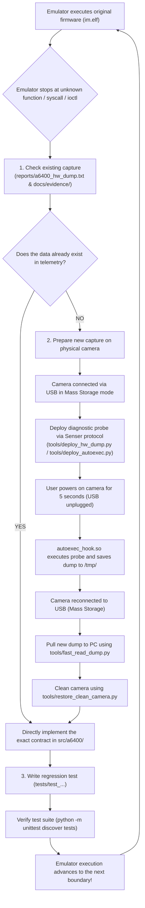

# Sony ILCE-6400 Emulator Enhancement Guide and Workflow

This document defines the official, repeatable, and strictly verified workflow for developing and improving the Sony ILCE-6400 camera emulator.

The goal is to establish a closed feedback loop: whenever the emulator encounters an unknown function, system call, `ioctl` code, or unimplemented device while executing original firmware (`im.elf`), the solution is derived directly from **live telemetry of real hardware**.

---

## 1. Workflow Architecture (Flowchart)



---

## 2. Phase 1: Checking Existing Captures (Ground Truth Baseline)

Before running a new capture on the camera, always check already-extracted data first. The file `reports/a6400_hw_dump.txt` contains **88,415 bytes (1,562 lines)** of clean data extracted directly from a physical Sony ILCE-6400:

### Available data in the existing dump:
1. **Device registry (`/proc/devices` and `/dev`):**
   * Shows exact **major and minor** numbers for all Sony proprietary drivers:
     * `/dev/dmpgles2`: Character major **248**, minor **29** (Sugilite GPU)
     * `/dev/hdmi`: Character major **248**, minor **25** (HDMI controller)
     * `/dev/hdmi_external_tx`: Character major **248**, minor **26**
     * `/dev/hdmi_input`: Character major **248**, minor **30**
     * `/dev/gpio`: Character major **240**, minor **0** (GPIO bus)
     * `/dev/stream`: Character major **249**, minor **7** (VRAM / OSD buffers)
     * `/dev/mmca1`: Block major **250**, minor **11** (SD card)
     * `/dev/usb/otgcore`: Character major **242**, minor **2**
     * `/dev/usb/event`: Character major **242**, minor **0**
2. **Physical memory layout (`/proc/iomem` and `/proc/cmdline`):**
   * Exact architecture: Quad-Core Cortex-A5 (CXD90045) with **1.25 GB physical RAM**:
     * Bank 0: `0x00000000 - 0x3fffffff` (1 GB)
     * Bank 1: `0x80000000 - 0x8fffffff` (256 MB)
   * Reserved uncached CMA ranges:
     * `0x14000000` (704 MB CMA)
     * `0x80e00000` (242 MB CMA)
3. **Loaded kernel modules (`/proc/modules` / `lsmod`):**
   * Complete list of active modules: `devno`, `mmc_drv`, `mcmn_drv`, `usbg_buspower`, `usb_darwin`, `hdmi`, etc.
4. **Main process address space (`/proc/149/maps` for `im.elf`):**
   * Exact location of all shared libraries in memory (`libObj.so` at VA `0x05d18000`).
   * Primary Sugilite VRAM stream at VA `0x08a5f000 - 0x0aa5f000` (physical PA `0x202e0000`, exactly 32 MiB).
   * OSD buffers at PA `0x23a80000` and `0x23b16000` (RGBA4444 format).
5. **Kernel dmesg log:**
   * Complete hardware bring-up sequence, clock initialization, sensors, and buses.

---

## 3. Phase 2: Protocol for a New Capture from the Physical Camera

When the emulator encounters data not present in the existing dump (e.g., contents of a specific C struct in RAM, response to a specific `ioctl`, reading a specific MMIO register, or a UIPC queue):

The camera is connected to the PC via USB cable in standard **Mass Storage mode**. There is no need to remove the SD card!

### Step 2.1: Preparing the diagnostic probe
Create a targeted script under `tools/` (or a temporary C program compiled using `tools/build.sh` into an ARM binary).

*Example template for an `autoexec.sh` probe:*
```sh
#!/bin/sh
export PATH=/usr/bin:/bin:/sbin:/usr/sbin:/tmp

OUT="/tmp/diag_result.txt"
echo "=== TARGETED DIAGNOSTIC CAPTURE ===" > "$OUT"

# 1. Example: Reading specific ioctl or sysfs parameters
# cat /sys/class/... >> "$OUT" 2>&1

# 2. Example: Reading thread or process state
# cat /proc/$(pidof im.elf)/status >> "$OUT" 2>&1

# 3. Example: Executing a targeted ARM test binary
# /tmp/my_probe >> "$OUT" 2>&1

sync
rm -f /tmp/autoexec.lock
```

### Step 2.2: Deploying the probe to the camera over USB
Run the deployment script via the `Sony-PMCA-RE` Senser protocol:
```powershell
python tools/deploy_autoexec.py
```
* **What happens:** The script automatically detects the camera in Mass Storage mode, sends the Sony Vendor command to switch to Senser mode, writes the probe into flash memory (`/tmp/autoexec.sh`), sets `/etc/ld.so.preload` to `/tmp/autoexec_hook.so`, and removes the lock file.

### Step 2.3: Execution on the camera (5 seconds)
1. Unplug the USB cable or power off the camera.
2. Power on the camera for 5 seconds.
3. During Linux boot, `autoexec_hook.so` intercepts initialization and runs `autoexec.sh` in the background.
4. Results are written immediately to `/tmp/diag_result.txt` (or a binary dump).
5. Power off the camera and reconnect it via USB cable to the PC in Mass Storage mode.

### Step 2.4: Fast retrieval of results to the PC
Run the patched fast reader to pull the file without stalling:
```powershell
python tools/fast_read_dump.py
```
* **Result:** The file is saved immediately to the host PC in the `reports/` directory.

### Step 2.5: Restoring the camera to a clean state (Safety Standard)
After the data has been retrieved, restore the camera's flash memory to a clean standby state:
```powershell
python tools/restore_clean_camera.py
```
* Temporary binary modules, dumps, and logs are deleted, and `autoexec.sh` is reset to a neutral state.

---

## 4. Phase 3: Implementation and Verification in the Emulator

Once we have authentic data from physical hardware, we move to the emulator code:

### 4.1. Where to implement the contract
* **New virtual device / character driver:**
  * Add under `src/a6400/hardware/` (e.g., `guest_hdmi.py`, `guest_gpio.py`, `guest_stream.py`).
  * Wire registration in `GuestKernel` with the exact `major` and `minor` numbers from `/proc/devices`.
* **System call / ioctl:**
  * Implement inside the corresponding `ioctl` handler in the driver.
  * Use exact binary structures (`ctypes` or `struct.unpack`) according to the ARM EABI standard.
* **Memory maps and VRAM:**
  * Configure exact physical and virtual addresses in `GuestMemory` and `GuestStream`.

### 4.2. Integrity rule (Zero Guesswork)
* **Forbidden:** Inventing behavior, guessing return codes, or inserting generic "dummy" responses unless confirmed by telemetry or firmware disassembly.
* **Mandatory:** Back every decision with a reference to a line in `reports/a6400_hw_dump.txt` or a corresponding Evidence document.

### 4.3. Testing and verification
Every new contract must have a corresponding unit test in `tests/`.

Run the full test suite:
```powershell
python -m unittest discover tests
```
* All 506+ tests must pass without errors (`OK`).

### 4.4. Documenting progress
1. Create a new record in `docs/evidence/` (e.g., `0075-...md`) describing:
   * What the obstacle / unknown function was.
   * How the data was read from real hardware.
   * What was implemented in the emulator.
   * To what instruction count emulator execution advanced.
2. Update `AGENTS.md` with the latest milestone.

---

## 5. Current Priority Task: Implementing `/dev/hdmi`

Following this workflow, the first task is unblocking the **85,766,715-instruction** boundary where the emulator stopped on `open("/dev/hdmi", O_RDWR)`:

1. **Check in existing dump:**
   * In `reports/a6400_hw_dump.txt` line 396 confirms:
     `crw-rw-rw- 1 root root 248, 25 /dev/hdmi`
2. **Implementation:**
   * Create `src/a6400/hardware/guest_hdmi.py` registering major 248, minor 25.
   * Support `open(O_RDWR)`, `fcntl(FD_CLOEXEC)`, `close`, and basic ioctl calls.
3. **Test:**
   * Write `tests/test_guest_hdmi.py`.
4. **Execution:**
   * Run the firmware and record crossing the 85.8M instruction boundary.
