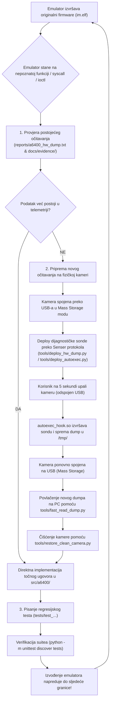

# Vodič i radni tok (Workflow) za poboljšanje Sony ILCE-6400 emulatora

Ovaj dokument definira službeni, ponovljivi i strogo verificirani radni tok za razvoj i poboljšavanje emulatora fotoaparata Sony ILCE-6400.

Cilj je stvoriti zatvorenu povratnu petlju (feedback loop): kada emulator tijekom izvođenja originalnog firmwarea (`im.elf`) naiđe na nepoznatu funkciju, sistemski poziv, `ioctl` kod ili neimplementirani uređaj, rješenje se pronalazi izravno iz **žive telemetrije stvarnog hardvera**.

---

## 1. Arhitektura radnog toka (Dijagram toka)



---

## 2. Faza 1: Provjera postojećeg očitavanja (Ground Truth baza)

Prije pokretanja novog očitanja na kameri, uvijek prvo provjeravamo već izvučene podatke. U datoteci `reports/a6400_hw_dump.txt` nalazi se **88.415 bajtova (1.562 linije)** čistih podataka izvučenih izravno s fizičkog Sony ILCE-6400:

### Dostupni podaci u postojećem dumpu:
1. **Registar uređaja (`/proc/devices` i `/dev`):**
   * Prikazuje točne **major i minor** brojeve za sve Sony vlasničke drivere:
     * `/dev/dmpgles2`: Character major **248**, minor **29** (GPU Sugilite)
     * `/dev/hdmi`: Character major **248**, minor **25** (HDMI kontroler)
     * `/dev/hdmi_external_tx`: Character major **248**, minor **26**
     * `/dev/hdmi_input`: Character major **248**, minor **30**
     * `/dev/gpio`: Character major **240**, minor **0** (GPIO sabirnica)
     * `/dev/stream`: Character major **249**, minor **7** (VRAM / OSD međuspremnici)
     * `/dev/mmca1`: Block major **250**, minor **11** (SD kartica)
     * `/dev/usb/otgcore`: Character major **242**, minor **2**
     * `/dev/usb/event`: Character major **242**, minor **0**
2. **Raspodjela fizičke memorije (`/proc/iomem` i `/proc/cmdline`):**
   * Točna arhitektura: Quad-Core Cortex-A5 (CXD90045) s **1.25 GB fizičkog RAM-a**:
     * Banka 0: `0x00000000 - 0x3fffffff` (1 GB)
     * Banka 1: `0x80000000 - 0x8fffffff` (256 MB)
   * Rezervirani nekachirani CMA rasponi:
     * `0x14000000` (704 MB CMA)
     * `0x80e00000` (242 MB CMA)
3. **Učitani kernel moduli (`/proc/modules` / `lsmod`):**
   * Kompletan popis aktivnih modula: `devno`, `mmc_drv`, `mcmn_drv`, `usbg_buspower`, `usb_darwin`, `hdmi`, itd.
4. **Adresni prostor glavnog procesa (`/proc/149/maps` za `im.elf`):**
   * Točna lokacija svih dijeljenih biblioteka u memoriji (`libObj.so` na VA `0x05d18000`).
   * Primarni Sugilite VRAM stream na VA `0x08a5f000 - 0x0aa5f000` (fizički PA `0x202e0000`, točno 32 MiB).
   * OSD međuspremnici na PA `0x23a80000` i `0x23b16000` (RGBA4444 format).
5. **Kernel dmesg log:**
   * Cjeloviti slijed podizanja hardvera, inicijalizacija taktova, senzora i sabirnica.

---

## 3. Faza 2: Protokol za novo očitavanje s fizičke kamere

Kada emulator naiđe na podatak koji se ne nalazi u postojećem dumpu (npr. sadržaj specifične C strukture u RAM-u, odgovor na točno određeni `ioctl`, očitanje specifičnog MMIO registra ili UIPC red čekanja):

Kamera je spojena na PC putem USB kabela i nalazi se u standardnom **Mass Storage modu**. Nije potrebno vaditi SD karticu!

### Korak 2.1: Priprema dijagnostičke sonde
Kreiramo ciljanu skriptu unutar `tools/` (ili privremeni C program kompajliran pomoću `tools/build.sh` u ARM binary).

*Primjer predloška za `autoexec.sh` sondu:*
```sh
#!/bin/sh
export PATH=/usr/bin:/bin:/sbin:/usr/sbin:/tmp

OUT="/tmp/diag_result.txt"
echo "=== CILJANO DIJAGNOSTICKO OCITANJE ===" > "$OUT"

# 1. Primjer: Ocitavanje specificnih ioctl ili sysfs parametara
# cat /sys/class/... >> "$OUT" 2>&1

# 2. Primjer: Ocitavanje stanja dretve ili procesa
# cat /proc/$(pidof im.elf)/status >> "$OUT" 2>&1

# 3. Primjer: Izvrsavanje ciljanog ARM testnog binaryja
# /tmp/my_probe >> "$OUT" 2>&1

sync
rm -f /tmp/autoexec.lock
```

### Korak 2.2: Učitavanje sonde na kameru preko USB-a
Pokrećemo skriptu za slanje preko `Sony-PMCA-RE` Senser protokola:
```powershell
python tools/deploy_autoexec.py
```
* **Što se događa:** Skripta automatski prepoznaje kameru u Mass Storage modu, šalje Sony Vendor naredbu za prebacivanje u Senser način rada, zapisuje sondu u flash memoriju (`/tmp/autoexec.sh`), postavlja `/etc/ld.so.preload` na `/tmp/autoexec_hook.so` i briše lock datoteku.

### Korak 2.3: Izvršavanje na kameri (5 sekundi)
1. Odspojite USB kabel ili ugasite kameru.
2. Upalite kameru na 5 sekundi.
3. Tijekom podizanja Linuxa, `autoexec_hook.so` presreće inicijalizaciju i u pozadini izvršava `autoexec.sh`.
4. Rezultati se trenutno zapisuju u `/tmp/diag_result.txt` (ili binarni dump).
5. Ugasite kameru i ponovno je spojite USB kabelom na računalo u Mass Storage mod.

### Korak 2.4: Brzo povlačenje rezultata na računalo
Pokrećemo zakrpani brzi čitač koji povlači datoteku bez zastoja:
```powershell
python tools/fast_read_dump.py
```
* **Rezultat:** Datoteka se trenutno sprema na host računalo u mapu `reports/`.

### Korak 2.5: Vraćanje kamere u čisto stanje (Sigurnosni standard)
Nakon što su podaci povučeni, flash memorija kamere se vraća u čisti standby mod:
```powershell
python tools/restore_clean_camera.py
```
* Brišu se privremeni binarni moduli, dumpovi i logovi, a `autoexec.sh` se postavlja u neutralno stanje.

---

## 4. Faza 3: Implementacija i verifikacija u emulatoru

Nakon što imamo autentičan podatak s fizičkog hardvera, prelazimo na kod emulatora:

### 4.1. Gdje implementirati ugovor
* **Novi virtualni uređaj / character driver:**
  * Dodati u `src/a6400/hardware/` (npr. `guest_hdmi.py`, `guest_gpio.py`, `guest_stream.py`).
  * Povezati registraciju u `GuestKernel` s točnim brojevima `major` i `minor` iz `/proc/devices`.
* **Sistemski poziv / ioctl:**
  * Implementirati unutar odgovarajućeg `ioctl` handlera u driveru.
  * Koristiti točne binarne strukture (`ctypes` ili `struct.unpack`) prema standardu ARM EABI.
* **Memorijske mape i VRAM:**
  * Konfigurirati točne fizičke i virtualne adrese u `GuestMemory` i `GuestStream`.

### 4.2. Pravilo integriteta (Zero Guesswork)
* **Zabranjeno je:** Izmišljati ponašanje, pogađati povratne kodove ili stavljati generičke "dummy" odgovore ako nisu potvrđeni telemetrijom ili disasembliranjem koda firmwarea.
* **Obavezno je:** Svaku odluku potkrijepiti referencom na liniju iz `reports/a6400_hw_dump.txt` ili odgovarajući Evidence dokument.

### 4.3. Testiranje i verifikacija
Svaki novi ugovor mora imati odgovarajući jedinični test u mapi `tests/`.

Pokretanje kompletnog testnog skupa:
```powershell
python -m unittest discover tests
```
* Svih 506+ testova mora prolaziti bez grešaka (`OK`).

### 4.4. Dokumentiranje napretka
1. Kreirati novi zapis u `docs/evidence/` (npr. `0075-...md`) s opisom:
   * Što je bila prepreka / nepoznata funkcija.
   * Kako je podatak očitan sa stvarnog hardvera.
   * Što je implementirano u emulatoru.
   * Do kojeg broja instrukcija je izvođenje emulatora napredovalo.
2. Ažurirati `AGENTS.md` s najnovijim milestoneom.

---

## 5. Trenutni prioritetni zadatak: Implementacija `/dev/hdmi`

Slijedeći ovaj workflow, prvi zadatak je deblokada granice od **85.766.715 instrukcija** gdje je emulator stao na `open("/dev/hdmi", O_RDWR)`:

1. **Provjera u postojećem dumpu:**
   * U `reports/a6400_hw_dump.txt` linija 396 potvrđuje:
     `crw-rw-rw- 1 root root 248, 25 /dev/hdmi`
2. **Implementacija:**
   * Kreirati `src/a6400/hardware/guest_hdmi.py` s registracijom major 248, minor 25.
   * Podržati `open(O_RDWR)`, `fcntl(FD_CLOEXEC)`, `close` i osnovne ioctl pozive.
3. **Test:**
   * Napisati `tests/test_guest_hdmi.py`.
4. **Izvršavanje:**
   * Pokrenuti firmware i zabilježiti prelazak granice od 85.8M instrukcija.
