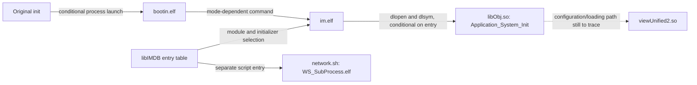

# E0002 — Original process startup and missing filesystem metadata

Date: 2026-10-18. Status: static findings verified against recorded local artifacts; runtime branch selection remains unverified.

## Startup chain

The strongest current UI-host candidate is `im.elf`. Evidence goes beyond matching strings:

1. In `nflasha7_unpacked/sbin/init`, `main` loads `/usr/bin/bootin.elf` at instruction `0x9b54` and calls `run_bg_process` at `0x9b56`. The helper contains `fork`/`execv` calls. Startup has conditional branches; this does not prove every mode launches the same process.
2. `bootin.elf` constructs or selects commands invoking `im.elf`. For example, instructions `0x9910` and `0x991a` load `im.elf s &` and `im.elf g &`, with a `system` call at `0x991c`. Other branches select other arguments. The normal camera boot argument has not been established.
3. In `im.elf`, a loader routine starts at `0xb200`. It reads a table-entry halfword at offset `0x0e`; for a nonzero value it selects `/usr/lib/libObj.so` at `0xb20e`–`0xb216`, then calls `dlopen` at `0xb21c`.
4. That routine reads a symbol-name pointer at table offset `0x14`, calls `dlsym` at `0xb240`, checks errors, and calls the resolved function at `0xb254`. This is original module initialization machinery that the prototype's manual factories bypass.
5. `libIMDB.so` exports the entry database. Its `IMDB_get_entries` adds `0x84` to the database base. `IMDB_find_entry` advances by `0x2c` and tests a sentinel value `0x28`. Decoding these observed fields yields 197 entries before the sentinel.
6. Entry 123 at `0xf0f8` contains `appFw.so` at offset `0x10`, `Application_System_Init` at offset `0x14`, and selector halfword `0x07fb` at offset `0x0e`. `Application_System_Init` is exported by `libObj.so` at `0x84320d` (Thumb). Combined with the loader routine, this supports an original `im.elf` → `libObj.so` initialization path when that entry is selected. Selection of the entry for a particular boot mode is still open.
7. `Application_System_Init` contains calls to `osal_create_thread` (`0x843256`) and `osal_set_cpu` (`0x84325e`), plus a PC-relative `AppConfig.so` reference (`0x84324a`). This path requires original scheduling/runtime behavior rather than a host-created screen object.



This replaces the earlier network-subprocess lead with a more specific UI-host candidate. It does not establish complete original UI startup or render output.

## Do not overinterpret generic table entries

The database also contains `gui.so` / `DPro_App_UI_init` at entry 126 and `/usr/bin/network.sh` at entry 193. The former is not a located standalone ELF in the extracted inventory. Shared product-family entries and mode masks must be interpreted before calling this a missing firmware requirement. The network script is a separate table entry; its presence does not make its subprocess the UI host.

The database contains `IMDB:qemu`, and `init` has a `check_qemu` function that reads `/proc/version` and compares consecutive characters to `qemu`. `bootin` contains a `target=qemu` command fragment. These are real implementation branches, not evidence of an available a6400 machine model or a complete QEMU launch configuration. Do not enable them as a shortcut to camera equivalence.

## Filesystem metadata recovered from original images

The bundled `fwtool.py` extraction entry point writes regular files and directories but omits symlink nodes (`fwtool.py/fwtool.py`, `writeFileTree`). Thus, a Windows extracted directory is not a faithful guest root filesystem even where its regular-file contents are correct.

The new read-only manifest command enumerates original `nflasha7` and `nflasha15` image nodes, including mode/owner/size and link targets. It recovered:

- 1,439 paths in the proposed combined guest namespace;
- 120 symlinks, including `/lib/ld-linux.so.3` → `ld-2.11.2.so` and `/lib/libc.so.6` → `libc-2.11.2.so`;
- all 14 static candidate objects for `im.elf`, its interpreter, and its DT_NEEDED closure, with no missing name references under the declared candidate search paths.

The proposed layout uses `nflasha7` as `/` after pivot and `nflasha15` as `/usr`. Actual root/mount state and loader policy still need runtime verification. Candidate paths `/lib` and `/usr/lib` are explicit assumptions, not a recovered search order. The planner retains every matching candidate and does not choose between ambiguous libraries.

No links were created on Windows and no extracted firmware files were changed. The manifest is a guest namespace model, not a runnable sysroot. Writable state, procfs, devices, dynamic module loading, version binding, and initialization order remain absent.

## Reproduction and artifacts

Run from the repository root with its Python environment:

```powershell
.\venv\Scripts\python.exe -m tools.research.elf_inventory
.\venv\Scripts\python.exe -m tools.research.startup_trace
.\venv\Scripts\python.exe -m tools.research.guest_layout
```

Generated local reports:

- `artifacts/inventory/startup-trace.json`: hashes, string offsets, literal pointers, bounded instruction blocks, PLT call names, and database entries.
- `artifacts/inventory/guest-filesystem.json`: original image hashes, metadata, links, and layout assumptions.
- `artifacts/inventory/im-process-plan.json`: candidate interpreter/dependency paths and remaining limitations.

PLT names are obtained by decoding ARM add/add/ldr stubs and matching their GOT addresses to relocation entries. Literal and PC-relative addresses are decoded from instruction operands. Linear disassembly can include literal pools; the report is not an executed control-flow trace. Manually selected block addresses are firmware specific and accompanied by artifact hashes.

## Additional identities

Paths relative to the extracted `0700_part_image/dev/` directory:

| Artifact | SHA-256 |
| --- | --- |
| `nflasha7_unpacked/sbin/init` | `0af5724ece7f60db2831b7a4e61829be369868027877cca0f921f981ae8dc7ad` |
| `nflasha15_unpacked/bin/bootin.elf` | `44788cd57d3befcb5552006d73e7b5a3d92847a5710c084c696564673e09aad7` |
| `nflasha15_unpacked/bin/im.elf` | `866729eb0bc1e6f5aba04d8bf8e45491985afe89a078ccb106a1ce2476865225` |
| `nflasha15_unpacked/lib/libIMDB.so` | `0a6537b9af4ebb964aa2f94c452776491dada0f554860503a7fd7dc9a445adfc` |

Next experiment: [bounded original interpreter execution](../experiments/0001-original-interpreter.md). No guest executable, kernel, or camera operation was run for this static investigation.
